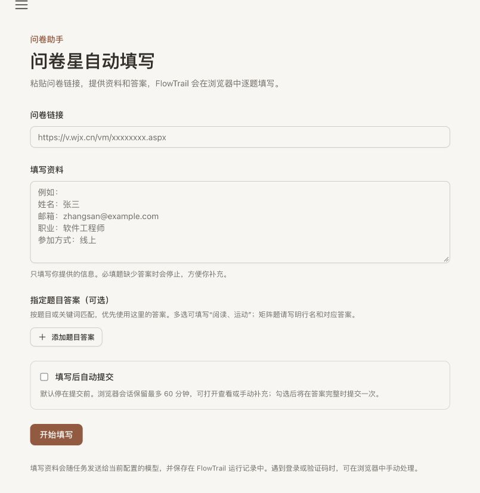
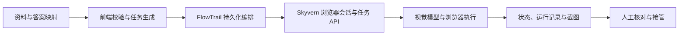

<div align="center">

# FlowTrail · 流迹

### 让 AI 填写问卷，让每一步都有迹可循。

可追溯的 AI 浏览器自动化工作台，基于 Skyvern。

[](LICENSE)
[](UPSTREAM.md)
[](docs/flowtrail/roadmap.md)

**简体中文** · [English](README.en.md)

[快速开始](docs/flowtrail/quickstart.md) · [使用说明](docs/wenjuanxing.md) · [项目结构](docs/flowtrail/structure.md) · [参与贡献](CONTRIBUTING.md)

</div>



## 从填写资料，到可核对的执行过程

把资料和逐题答案交给 FlowTrail，创建浏览器任务，在运行记录中查看操作与截图，需要时打开浏览器手动处理。当前聚焦中文问卷填写，适合本地演示、场景开发和浏览器 Agent 集成实验。

| 能力 | 你可以做什么 |
| --- | --- |
| 中文问卷入口 | 校验问卷星链接，输入资料，指定“题目或关键词 → 答案” |
| 可追溯执行 | 查看任务状态、运行记录、操作截图与浏览器会话 |
| 人工接管入口 | 打开浏览器核对或补充；指令要求遇到登录、验证码时停止 |
| 明确填写意图 | 默认要求只填写，显式选择后才要求提交 |
| 持久化任务编排 | 同编号请求去重、异常查询恢复、取消确认与会话释放 |
| 本地模型接入 | 使用百炼 OpenAI-compatible 配置和模型注册脚本 |
| 执行报告 | 查看和导出执行摘要，明确区分执行器状态与独立核验 |
| 可重复评测 | 三种固定场景、重复运行、逐项证据、失败分类和耗时统计 |

> **实验阶段**：提交策略由模型指令约束，尚无浏览器层的强制提交拦截。当前验证覆盖本地夹具，不能代表所有真实问卷星题型或通用成功率。

## 开始使用

需要 Docker Compose **2.24.4+**、Node.js **22+**、Python **3.11+**，以及支持视觉输入的百炼模型密钥。

```bash
git clone https://github.com/unumbrela/flowtrail.git
cd flowtrail
cp .env.example .env
cp .env.bailian.example .env.bailian
cp skyvern-frontend/.env.example skyvern-frontend/.env
```

在 `.env.bailian` 填入模型密钥，并删除 `skyvern-frontend/.env` 中的 `VITE_SKYVERN_API_KEY=YOUR_API_KEY` 占位行。以下命令在仓库根目录执行：

```bash
npm --prefix skyvern-frontend ci
npm --prefix skyvern-frontend run build
docker compose up -d
# 等待 docker compose ps 中后端显示 healthy，再注册模型：
python3 scripts/setup_bailian.py
```

打开 **[本地问卷工作台](http://localhost:8080/wenjuanxing)**。完整配置、镜像说明和排错见[本地启动指南](docs/flowtrail/quickstart.md)。模型执行会产生模型用量。

## 工作原理



FlowTrail 的场景入口、任务策略和本地验证建立在 Skyvern 执行引擎之上。Python 包名、API 和容器服务名保留 `skyvern`；详细来源与兼容边界见 [UPSTREAM.md](UPSTREAM.md)。默认部署使用固定后端镜像，本地后端源码修改需要另行构建镜像。

## 找到你需要的内容

| 我想… | 从这里开始 |
| --- | --- |
| 启动并试用 | [快速开始](docs/flowtrail/quickstart.md) |
| 理解填写和提交行为 | [问卷使用说明与边界](docs/wenjuanxing.md) |
| 找代码、理解目录 | [项目结构与修改入口](docs/flowtrail/structure.md) |
| 理解任务恢复与幂等协议 | [第二轮任务生命周期](docs/flowtrail/lifecycle.md) |
| 查看报告与复现评测 | [第三轮执行报告与评测](docs/flowtrail/evaluation.md) |
| 复现测试 | [验证指南](docs/flowtrail/testing.md) |
| 理解设计取舍 | [贡献与设计说明](docs/portfolio/contributions.md) |
| 参与后续开发 | [路线图](docs/flowtrail/roadmap.md) · [贡献指南](CONTRIBUTING.md) |
| 查看上游资料 | [Skyvern 原始 README](README.upstream.md) |

## 一起完善 FlowTrail

欢迎改进题型覆盖、失败诊断、文档和可复现测试。提交问题时请附上脱敏后的复现步骤；新增题型最好附上本地夹具。具体流程见[贡献指南](CONTRIBUTING.md)。如果项目对你有帮助，欢迎 Star 或分享实际使用反馈。

## 许可与致谢

基于 [Skyvern](https://github.com/Skyvern-AI/skyvern) 的 fork，遵循 [GNU AGPL v3](LICENSE)。保留上游版权与许可声明；FlowTrail 改动范围见[设计说明](docs/portfolio/contributions.md)。
