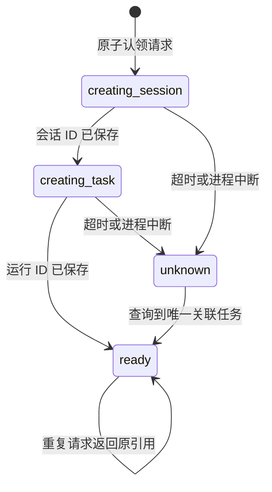

# 第二轮：持久化任务编排与恢复

FlowTrail 现在通过独立编排服务创建问卷任务。服务复用固定 Skyvern 镜像中的 FastAPI / HTTPX 运行时，源码单独挂载，不修改上游执行引擎。

## 创建协议

1. 前端在发送请求前生成随机 operation ID，并写入 URL。
2. 编排服务使用调用者凭据向 Skyvern 验证组织身份。
3. SQLite 以 `(organization_id, operation_id)` 唯一约束认领请求，保存规范化请求摘要。
4. 同编号、同内容只返回原记录；同编号、不同内容返回 `409 idempotency_conflict`。
5. 在每个创建动作之前提交阶段记录，然后创建浏览器和任务。上游任务标题包含服务端生成的关联编号。
6. 响应丢失时，查询按精确标题和浏览器会话匹配原任务。没有唯一匹配就保留未知状态，不重新创建。



协议保证的是：**在幂等记录保留期间，每个组织内同一 operation ID 的各个创建动作最多发送一次**。上游接口没有原子幂等创建协议，因此不能宣称执行恰好一次。进程在记录阶段后、真正发请求前退出时，也会保留未知状态；这是以可用性换取避免重复创建的取舍。

如果浏览器创建响应丢失，服务可能没有拿到会话 ID。此时不能可靠关联或主动关闭该会话，不会凭时间近似匹配。服务请求了 60 分钟会话超时，实际资源回收仍由 Skyvern 负责。

## 前端恢复

- 新链接使用 `?operation=<id>`；旧版 `run/session/mode` 链接仍可查看。
- 刷新后只查询原 operation，不自动重新创建。表单资料不写入 URL 或浏览器存储。
- 页面仍持有原请求时，可点击“重发同一请求”，使用原编号和原内容。
- 刷新导致原表单资料丢失、服务端又没有收到请求时，无法重建该请求内容；可继续查询或到 Runs 核查，不能声称所有网络故障都能自动恢复。
- 不会在编排服务不可用时退回直接创建接口，这会绕过幂等协议。

## 取消与会话管理

| 操作 | 行为 |
| --- | --- |
| 取消任务 | 服务端重新读取任务状态，向执行器发出取消请求；UI 等待实际终态，不把请求成功当作已取消 |
| 关闭浏览器 | 仅在已确认任务终态后允许；运行中或创建结果未知时返回 409 |
| 重复关闭 | 已确认关闭则返回原状态；关闭响应丢失后可通过后端状态确认 |
| 保留浏览器，填写另一份 | 用户明确选择保留当前会话供核对；后端超时仍适用 |
| 已关闭或不可用 | UI 移除打开浏览器入口 |

取消与关闭操作有服务端互斥标记。单进程重启清理遗留操作标记；重试仍先读取后端状态。

## 部署与数据

`docker compose up -d` 会启动 `flowtrail` 服务，监听本机 `8001` 端口。前端默认使用 API 所在主机的 `8001/v1`；需要修改地址时配置 `VITE_FLOWTRAIL_API_BASE_URL` 并重建前端。自定义前端来源需同时配置 `FLOWTRAIL_ORIGINS`。

- 持久化目录：`.flowtrail/operations.sqlite3`，已加入 Git 忽略。
- **不要把 `.flowtrail/` 当成测试缓存删除**；删除它会丢失幂等和恢复记录。迁移部署时备份该目录；运行期间使用 SQLite backup API，或停止服务后复制整个目录。
- 表中保存组织、请求摘要、创建阶段、运行/会话引用和操作标记，不保存模型密钥、认证凭据或表单正文。正文仍会进入 Skyvern 原有运行记录。
- 每次 API 调用重新验证身份，组织由上游返回，不接受浏览器传入的组织标识。凭据只用于本次转发，不落盘。
- 当前支持单节点、单 worker 部署，不是分布式任务队列。不要同时启动多个服务实例对同一数据目录执行启动恢复。
- 初次部署需可写数据目录；该服务不需要独立模型密钥。

## 验证

无模型的后端测试覆盖并发认领、内容冲突、跨组织访问、创建响应丢失、进程中断、恢复匹配、取消与关闭保护，以及真实 ASGI 鉴权边界：

```bash
# 在已启动的固定镜像容器中运行，无需本机安装后端依赖：
docker compose exec -T flowtrail sh -c 'cd /workspace && python -m unittest discover -s flowtrail_service/tests -p "test_*.py"'
```

CI 在 Python 3.11 环境安装 `flowtrail_service/requirements-test.txt` 后执行同一测试集，不调用模型。

真实模型测试会产生用量，使用虚构资料与本地夹具：

```bash
node skyvern-frontend/scripts/wenjuanxing-smoke.mjs missing --lifecycle
node skyvern-frontend/scripts/flowtrail-lifecycle-smoke.mjs
```

第一条会并发提交相同请求、重放请求、检查内容冲突，最后验证只有一个关联任务和重复关闭会话；第二条验证运行中关闭被拒绝、取消确认以及重复释放资源。`fill` 和 `submit` 也支持 `--lifecycle`。

### 本轮实际记录（2026-10-24）

- 并发创建与缺失邮箱验证：operation `db930b161da8473cb04ae13f29633469`，run `tsk_588982709877412552`。结构化缺失邮箱错误、空邮箱观测、零提交回执通过；服务端查询确认只有一个关联任务。
- 取消与资源释放：operation `68c214c178ab4ddea89940a7e2194412`，run `tsk_588983229568455480`。运行中关闭返回 409，最终状态为 canceled，重复关闭通过。
- 加入“关闭请求成功不等于会话已经关闭”的二次状态核验后复测：operation `870aaad5f0ed402b91b0beb4e78f4000`，run `tsk_588984195936097116`，取消、关闭与重复请求验证通过。
- 容器重建后再次读取第一条 operation，运行和会话引用保持一致。
- 无模型检查：98 项前端定向测试、16 项编排/HTTP 边界测试通过；TypeScript、定向 ESLint、Ruff 和生产构建通过，构建仍有大包警告。全仓 pre-commit 因未安装未完成，远程 CI 尚未运行。
- 实际浏览器打开最后一条 operation 链接，确认恢复为“已取消”，会话显示已关闭且不再提供浏览器入口。
- 上述为本地验收，不代表分布式部署或外部网站的成功率。原始报告保存在 `artifacts/wenjuanxing/` 和 `artifacts/flowtrail/`，与持久化幂等记录分开。

实现入口：[协调器](../../flowtrail_service/coordinator.py)、[HTTP 边界](../../flowtrail_service/api.py)、[前端](../../skyvern-frontend/src/routes/wenjuanxing/WenjuanxingPage.tsx)。
